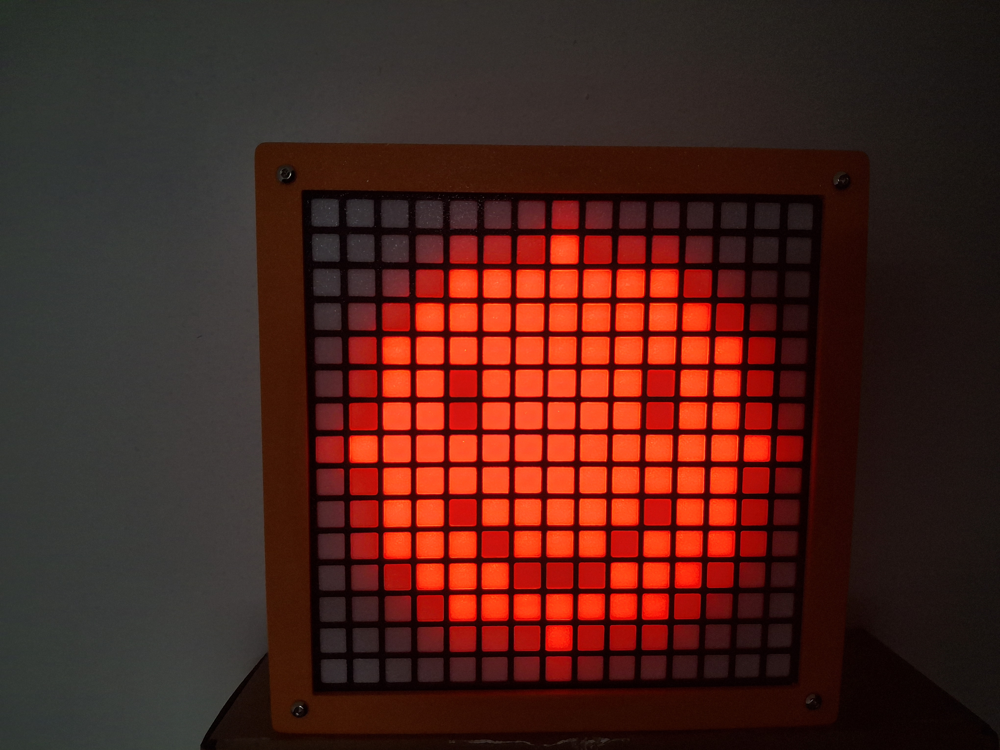
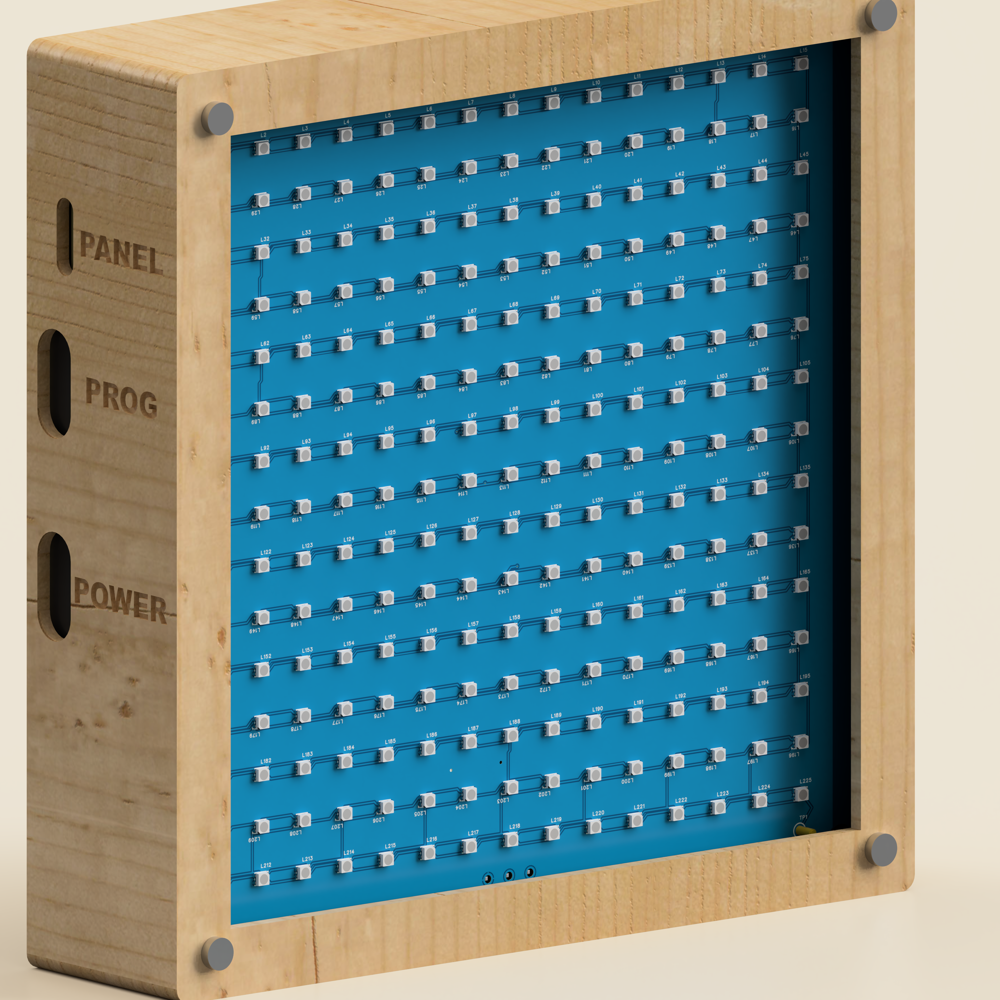
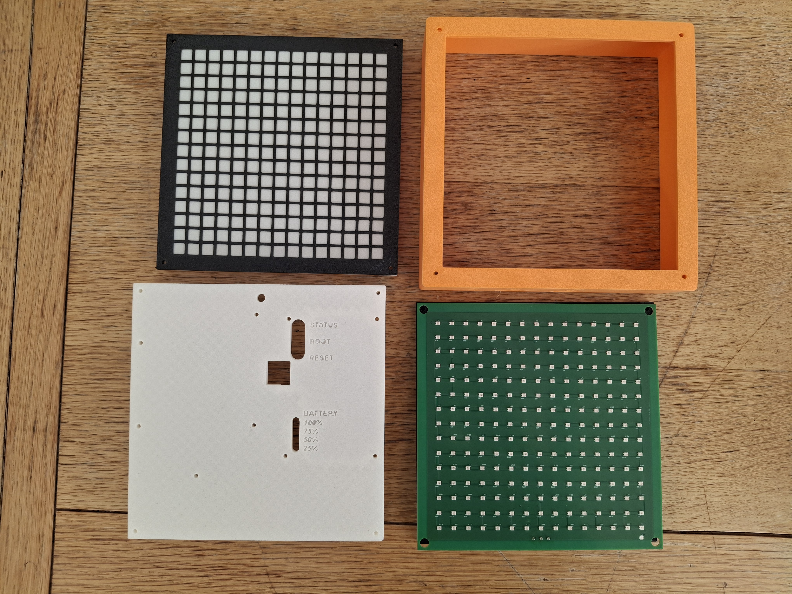

# Pixel Mood Lamp

A 15 × 15 RGB pixel lamp designed by **Onyedikachi Elvis Ezeoke**: a custom 225-LED PCB, a divided diffuser and an orange enclosure, with programmable faces and animations.



The first panel has been manufactured and assembled. An Arduino Uno drives the demonstrated prototype. This release shares the LED-panel manufacturing files, enclosure STEP files, Arduino sketches and an offline animation preview.

## Watch the animation

Download or clone this repository and open **[Mood Lamp Animation Preview](visualizations/panel-emoji-show.html)** in a browser. GitHub's file view shows source; open the downloaded HTML to play it. It works offline and includes fullscreen, pause, replay and scene selection.

The 18-second loop runs Pac-Man-style chomping, laughter with tears, a happy wink, sunglasses and a Halloween pumpkin. The browser and Arduino use the same generated pixel frames and timing.

## Build and run

1. Use `hardware/led-panel/` for the Gerber ZIP, component BOM and placement/CPL file. Assembly requires all three, not only Gerbers.
2. Use `hardware/enclosure/` for the enclosure and optical parts. The STEP variants are design alternatives, not a requirement to print both light grids. Choose an opaque divider and translucent diffuser.
3. Open `firmware/PanelEmojiShow/PanelEmojiShow.ino` in Arduino IDE with `EmojiShowData.h` in the same folder. Install **Adafruit NeoPixel**, choose Arduino Uno and its connected port, then upload.
4. Connect Uno **D6 to panel DATA**, and share **GND** between panel, controller and supply. Feed the panel directly from a regulated **5 V supply**, not through the Uno's 5 V pin. The panel connector is P1: **1 DATA, 2 GND, 3 +5 V**; verify the board markings and orientation before connecting.

The panel uses WS2812B-2427-V6 LEDs, GRB order and horizontal serpentine addressing. The sketch starts at `DEMO_BRIGHTNESS = 8` out of 255. A higher value changes power demand; supply capacity, wiring and panel temperature must be checked for the intended pattern. Do not connect 6 V or 7.4 V battery packs directly to this 5 V panel.

## Files

| Folder | Contents |
|---|---|
| `firmware/PanelEmojiShow` | Main emoji animation, compiled and uploaded to an Uno |
| `firmware/PanelFirstPowerTest` | One-pixel red/green/blue chase for initial checks |
| `firmware/PanelAnimationsDemo` | Earlier smile, colour and rainbow demo |
| `visualizations` | Standalone HTML player and shared frame JSON |
| `tools` | Python generators and HTML template |
| `hardware/led-panel` | LED-panel Gerbers, BOM and placement export |
| `hardware/enclosure` | Original enclosure and diffuser STEP exports |
| `media` | Design render and physical prototype photos |




## Revision and test notes

This is the **Iteration 1 working prototype**, not a certified consumer product. The optical face and serial chain have been demonstrated. Sustained full-white current, temperature and endurance remain unqualified. An intermittent end-of-chain pixel glitch was reported during handling; check secure DATA/GND wiring and supply voltage if it recurs.

The LED Gerber's corner openings are approximately 6 mm, while the enclosure fastener intent is four M3 × 50 mm screws. Check fit and use appropriate wide washers/centring sleeves rather than assuming a 3 mm PCB hole. The rear plate includes features for the original custom controller; adapt it for your actual controller. The custom rechargeable controller was not manufactured and is not included in this release. Third-party screw, battery and PCB component-body models are also excluded.

On the Uno, the emoji sketch reserves Timer1 for consistent animation timing; do not combine it with Servo or Timer1 PWM without adapting the clock. Compile verification used Arduino AVR 1.8.7 and Adafruit NeoPixel 1.15.5. The HTML shows lifted screen exposure, not calibrated physical brightness.

## Change the animation

Run with Python 3 from this repository's root:

```sh
python tools/build_emoji_animation.py
python tools/build_emoji_preview.py
```

The generated header and HTML share 49 unique frames and 99 timed holds over 18,000 ms. Edit the generator for artwork and timing; edit the template for the player interface. The sketch's brightness setting is not overwritten by asset generation.

## Manufacturing and support

Thanks to **PCBWay** for helping bring the panel to life. A project ordering/referral link will be added when available. The Gerbers remain downloadable here so you can use your preferred manufacturer. Any future referral link will be labelled as such.

## Licensing

Copyright © 2026 Onyedikachi Elvis Ezeoke. Original code in `firmware/`, `tools/` and `visualizations/` is **MIT**; original hardware design material in `hardware/` is **CERN-OHL-P-2.0**; original documentation and media are **CC BY 4.0**. See [LICENSE.md](LICENSE.md) and `LICENSES/` for scope and full texts. Attribute the project and author when sharing original documentation or images.

Adafruit NeoPixel is an external dependency under its own licence and is not vendored. Third-party names, trademarks and recognizable character references are not claimed as original intellectual property or licensed by this project. No affiliation with their owners is implied.
